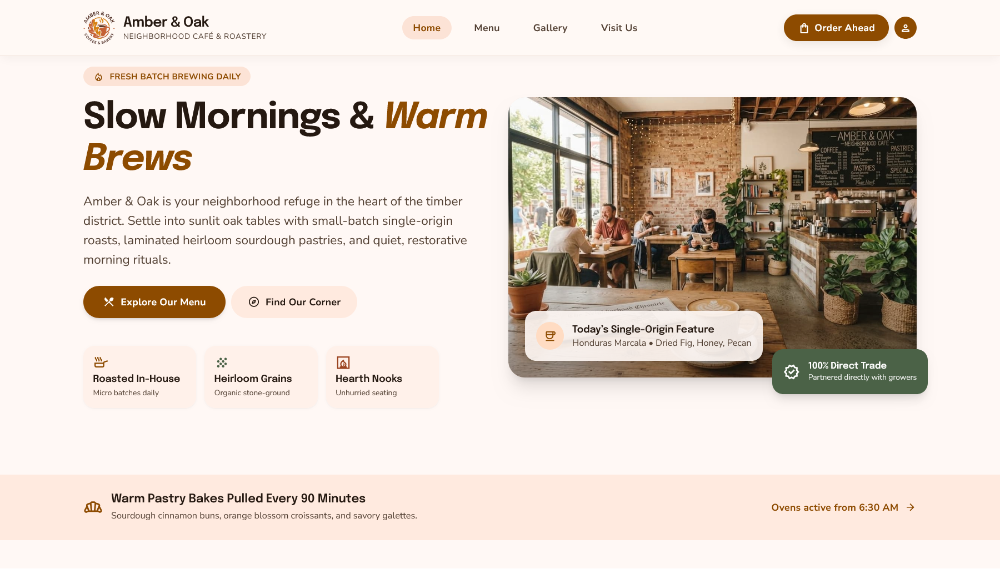
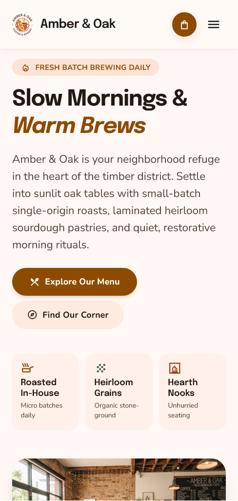

# Amber & Oak

A responsive website for a fictional neighborhood café and roastery, built to practise turning a UI design into a production-ready React site.

**Live site:** [amber-and-oak-cafe.vercel.app](https://amber-and-oak-cafe.vercel.app)





> **Demo project.** The café, menu, prices and details are all fictional.

## Features

- Responsive from phones to large screens, with tablet layouts planned in from the start
- Scroll-aware navigation that highlights the current section, built as a reusable custom hook (`useActiveSection`), plus a mobile menu
- Data-driven menu: 14 items across three categories, rendered from a single data file with nested lists
- Gallery with a "spotlight" filter: photos outside the chosen category fade and desaturate instead of disappearing, so the layout never jumps
- One source of truth for opening hours and address (`src/data/cafe.js`), shared by the Visit section and the footer so they can't disagree
- Illustrated fictional map with an animated location pin (the pulse switches off for visitors who prefer reduced motion)
- Newsletter signup with built-in validation and a success state (front-end only)
- Design tokens (colors, type scale, spacing, radii) copied exactly from the original design into the Tailwind config
- Small reusable pieces: an `Icon` component and a `MenuItem` card

## Built with

- [React](https://react.dev/) + [Vite](https://vite.dev/)
- [Tailwind CSS](https://tailwindcss.com/) v3
- Google Fonts: Epilogue and Nunito Sans, with Material Symbols for icons
- Deployed on [Vercel](https://vercel.com/)

## Process

The visual direction and prompts were mine; the first design draft was generated in Google Stitch. I then rebuilt it by hand, one component at a time, with Claude as a step-by-step guide: porting the design tokens, adding the missing mobile navigation, fixing tablet and phone layouts, replacing a Google-branded map image with an original illustration, and wiring up the interactive parts (scroll-aware nav, gallery filter, forms).

## Run locally

```bash
git clone https://github.com/Keonii01/amber-and-oak.git
cd amber-and-oak
npm install
npm run dev
```

Build for production with `npm run build`, and preview that build with `npm run preview` (run `build` again after any change).

## Project structure

```
src/
  components/   Navbar, Hero, PastryBanner, Menu, MenuItem, Gallery,
                Visit, Newsletter, Footer, Icon
  hooks/        useActiveSection.js
  data/         menu.js, gallery.js, cafe.js
public/
  images/       logo, hero, gallery photos, map
```

## Known limitations and next steps

- "Order Ahead" scrolls to the menu; there is no ordering system.
- The newsletter form is front-end only. It validates and shows a confirmation, but nothing is sent yet.
- Social and policy links in the footer are placeholders.
- The map is an illustration of a made-up neighborhood, not an interactive map.

## Author

Dami ([@Keonii01](https://github.com/Keonii01))
